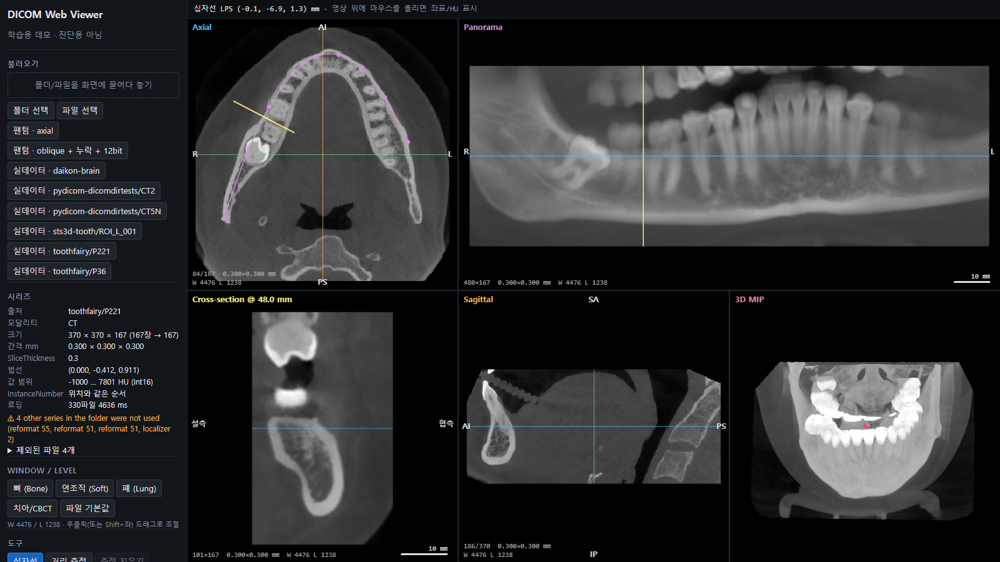
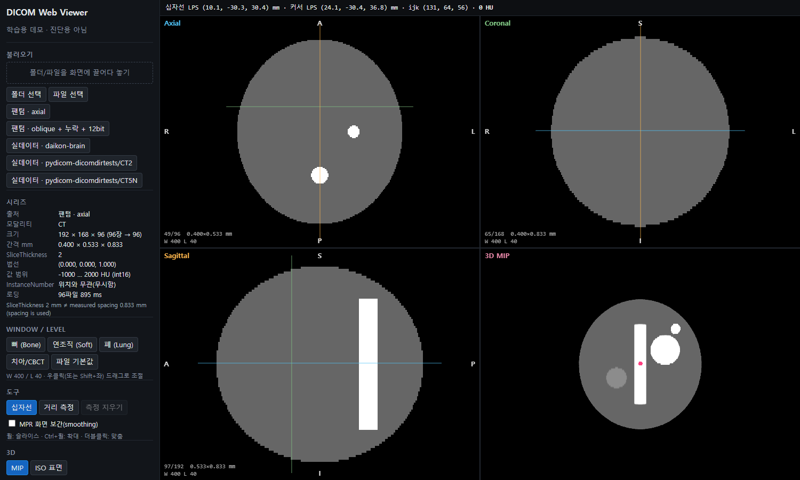
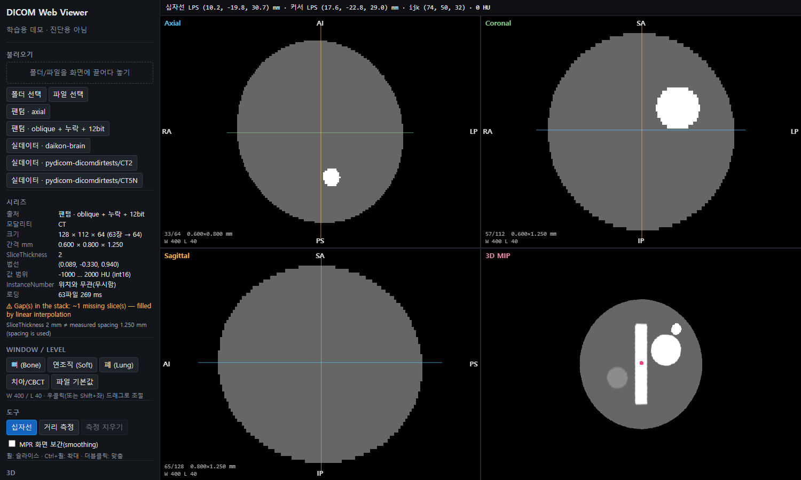
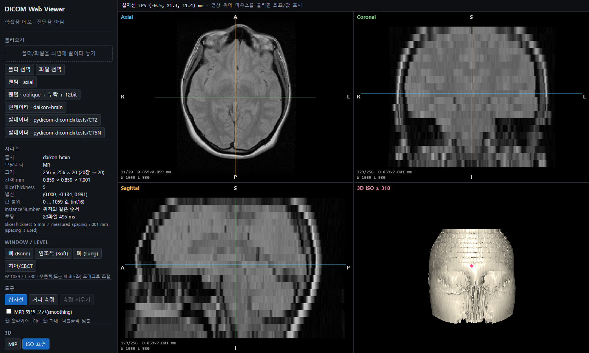

# DICOM Web Viewer (학습용 데모)

브라우저에서 DICOM CT 시리즈를 읽어 **기하학적으로 올바른 볼륨**을 만들고, MPR(axial/coronal/sagittal)과 WebGL2 3D(MIP / ISO 표면)로 보여 주는 데모다.
의료 영상을 처음 다루면서 "좌표가 맞는지 어떻게 아는가"에 집중했다. 겪은 문제와 결정은 [`docs/DEV-LOG.md`](docs/DEV-LOG.md)에 기록했다.

**치과 CBCT**: 실제 장비(NewTom VGi) 원본으로 파노라마·cross-section을 만들고, 장비 SW가 만든 재구성 영상·ITK와 수치로 비교했다 → [`docs/DENTAL-LOG.md`](docs/DENTAL-LOG.md)



> ⚠ 의료기기가 아니다. 진단용으로 쓸 수 없다. → [`docs/LIMITS.md`](docs/LIMITS.md)



## 하는 일

| 단계 | 내용 |
|---|---|
| 불러오기 | 폴더/파일 드래그앤드롭, 폴더·파일 선택, 내장 합성 팬텀 버튼, (개발 서버에서) 공개 실데이터 버튼. 파싱은 [`dicom-parser`](https://github.com/cornerstonejs/dicomParser). Implicit/Explicit VR Little Endian |
| 볼륨 구성 | IOP로 법선 `n = row × col`을 구하고 **`IPP · n`으로 정렬**한다(파일명·InstanceNumber는 쓰지 않음). 간격은 IPP로 측정한다(SliceThickness는 쓰지 않음). gap과 비균일 간격은 검출해 보고하고 리샘플링한다. BitsStored 마스킹, signed 부호 확장, Rescale slope/intercept → HU |
| MPR | 3면 동시 표시. 십자선을 공유한다(클릭·드래그하면 다른 면이 따라감). 물리 간격 기준 종횡비. 방향 글자는 방향 코사인에서 계산. W/L 프리셋 + 우클릭 드래그. 휠로 슬라이스 이동 |
| 좌표/측정 | 커서 아래의 **LPS(mm) 좌표 + HU** 표시. 두 점 거리(mm) 측정(환자 좌표에서 계산) |
| 치과 | 치과 모드: 자동 치열궁 추정(슬랩 MIP 상위 6% + RANSAC 포물선) 또는 직접 찍기 → Catmull-Rom 곡선(호의 길이 등간격) → 파노라마(두께 평균) + cross-section(설측/협측). 파노라마 클릭으로 단면·십자선 연동 |
| 3D | Three.js `Data3DTexture`(R16F, HU 원값) + 레이마칭 셰이더. MIP(MPR과 같은 W/L) / ISO 표면(임계값, 이분법 정제, 그래디언트 조명). 볼륨을 LPS 공간에 배치. 메모리 예산을 넘으면 다운샘플 |

## 실행

```bash
npm install
npm run dev            # http://localhost:5190  (포트 고정, --strictPort)
```

- 처음 열면 합성 팬텀(axial)이 자동으로 로드된다. 왼쪽 버튼으로 oblique+슬라이스 누락+12bit 팬텀으로 바꿀 수 있다.
- 실제 공개 샘플(선택): `npm run fetch-samples` → 개발 서버를 다시 열면 "실데이터" 버튼이 생긴다. 출처·라이선스는 [`data/external/README.md`](data/external/README.md)에 있다.
- 조작
  - 좌클릭/드래그: 십자선
  - 우클릭(또는 Shift+좌) 드래그: W/L
  - 휠: 슬라이스
  - Ctrl+휠: 확대
  - 더블클릭: 맞춤
  - 3D는 드래그 회전, 휠 줌

### 클라우드 (장비 PC → S3 → 웹)

업로드가 끊기거나, 회선이 느리거나, 권한이 없을 때 어떻게 되는지 확인하려고 만든 부분이다. 기록: [`docs/CLOUD-LOG.md`](docs/CLOUD-LOG.md)

```bash
npm run s3        # 로컬 S3 (SeaweedFS, .tools/weed.exe) :8333
npm run api       # API (Node · Fastify · SQLite) :5191, 데모 계정 자동 생성
npm run upload -- --dir data/external/toothfairy/raw/P221 --patient P221             # 장비 PC 업로드
npm run upload -- --dir … --patient P221 --cut-after 120                             # 끊김 재현 → 다시 실행하면 이어 올림
python scripts/desktop_points.py data/external/toothfairy/raw/P221 P221              # "장비 PC 뷰어"가 찍은 점 저장
node cloud/measure-load.mjs .data/measure                                             # 느린 회선·CPU에서 첫 화면 시간
```

- 데모 계정: `dentist@a.test / dentist-a`(A치과), `device@a.test / device-a`(A치과 장비), `dentist@b.test / dentist-b`(B치과)
- 뷰어 왼쪽 "클라우드"에서 로그인 → 검사를 고르면 저해상도(1/8)가 먼저 뜨고 원본으로 바뀐다. 장비 PC에서 찍은 점은 주황 원으로 표시된다.
- AWS로 옮길 때는 `S3_ENDPOINT`, `S3_KEY`, `S3_SECRET`, `JWT_SECRET` 환경변수만 바꾸도록 작성했다(`cloud/config.ts`). 실제 AWS에서는 아직 실행하지 않았다.

### 기타 명령

```bash
npm test               # vitest: 팬텀 기하/HU/좌표 + 실데이터(있으면) + 텍스처/WL/MPR
npm run build          # 타입체크 + 프로덕션 빌드
npm run phantom        # 팬텀 DICOM 시리즈 + truth.json을 data/phantom/ 에 쓰기
npm run inspect -- <폴더>   # 로더가 시리즈를 어떻게 판단했는지 출력
python scripts/nifti_to_dicom.py <in.nii.gz> <out_dir>   # NIfTI(RAS) → DICOM 시리즈(LPS)
python scripts/validate_sitk.py <dicom_dir> <out.json>    # ITK 기준값 → tests/external.test.ts가 비교
npx vite-node scripts/bench.ts 512x512x300   # CPU측 로딩/텍스처 준비 시간
node scripts/screens.mjs   # 개발 서버를 띄운 상태에서 headless 스크린샷 → docs/screens/
python scripts/validate_pydicom.py data/phantom/axial   # pydicom으로 독립 교차 검증 (pip install pydicom numpy)
```

## 검증 방법 요약

- **합성 팬텀**(`src/phantom/`)
  - 알려진 LPS 위치에 구(뼈 1000, 연조직 60, 지방 −100), S-I 원기둥(300), 물 타원체(0), 비대칭 "LPS 마커"(2000)를 넣는다.
  - 파일명과 InstanceNumber는 무작위로 섞는다. 비정사각 픽셀(0.8×0.6), SliceThickness ≠ 간격으로 만든다.
  - 옵션: oblique(tilt/yaw), 슬라이스 누락, signed/unsigned, BitsStored 12 + 상위 비트 쓰레기, slope 0.5, implicit VR.
- **테스트**: 정렬, 간격, gap, HU, voxel↔patient 왕복, oblique 25°/30°에서의 물체 위치, 거리 보존, UID 규칙.
- **테스트의 테스트**: 흔한 실수 6가지를 일부러 넣었을 때 각각 3–18개 테스트가 실패하는 것을 확인했다(DEV-LOG #2–#8).
- **독립 구현**: 같은 팬텀 파일을 pydicom으로 읽어 같은 위치에서 같은 HU가 나오는지 확인했다. 이 과정에서 UID 규칙 위반을 찾아 고쳤다(#9).
- **실데이터**: pydicom 테스트 CT(InstanceNumber 역순, 202 mm gap), Daikon MR(oblique 7.7°, 두께 5 mm vs 간격 7.0 mm, IPP 0.1 mm 반올림).

## 스크린샷 (`docs/screens/`, Playwright headless + SwiftShader)

| 파일 | 내용 |
|---|---|
| `01-phantom-mip.png` | 팬텀 axial. 십자선 공유, 커서 LPS/HU, 3D MIP |
| `02-phantom-iso-measure.png` | 뼈 W/L, 거리 측정(mm), 3D ISO ≥ 300 HU |
| `03-phantom-oblique-gap.png` | oblique 20°/15° + 슬라이스 1장 누락(경고 표시) + unsigned 12bit. 3D는 01과 같은 방향으로 보인다(LPS 배치) |
| `04-real-mr-oblique.png` | 실데이터 MR(Daikon). oblique, 간격 7.0 mm(두께 5 mm), 종횡비 |
| `05-real-mr-iso.png` | 같은 MR의 ISO 표면(전면에서 본 얼굴, S가 위) |
| `06-real-ct-gap.png` | 실데이터 CT2. 202 mm 떨어진 1장을 제외(경고) |
| `07`/`08`/`09-mip-step*.png` | 레이 스텝 아티팩트: 0.25 샘플/복셀 지터 없음 → 동심원 무늬, 지터 → 노이즈, 3 샘플/복셀 → 깨끗 |
| `10-file-input-implicit-12bit.png` | 디스크에 쓴 팬텀(implicit VR, 12bit, 쓰레기 비트)을 파일 선택으로 로드 |




## 구조

```
src/dicom/      parse.ts (태그 해석, 저장값 디코딩) · volume.ts (정렬/간격/HU/좌표) · mpr.ts · window.ts · load.ts
src/phantom/    dicomWriter.ts (최소 Part10 writer) · phantom.ts (정답이 있는 합성 시리즈)
src/view/       MprView.tsx · fileInput.ts
src/three/      VolumeView.tsx · raymarch.ts (GLSL) · volumeTexture.ts (R16F, 다운샘플)
tests/          phantom / external / texture 테스트
scripts/        gen-phantom · inspect-series · bench · screens · fetch-samples · validate_pydicom.py
docs/           DEV-LOG · DENTAL-LOG · CLOUD-LOG · LIMITS · screens/
```

스택: Vite 8, React 19, TypeScript 5.9, Three.js 0.186, dicom-parser 1.8, Vitest 5. 런타임 의존성은 4개다(react, react-dom, three, dicom-parser).
