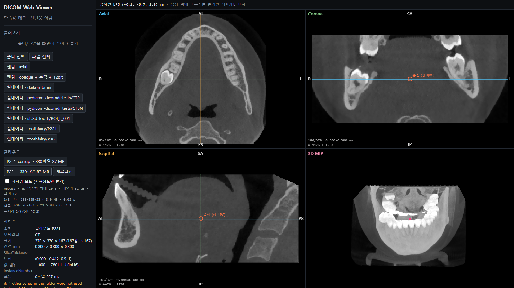
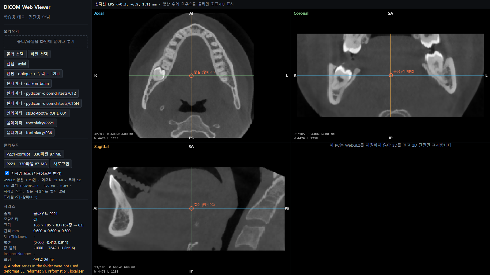

# CLOUD-LOG — 장비 PC → 클라우드 → 웹 뷰어

질문은 네 가지였다. 업로드가 끊기면? 느린 회선·약한 PC면? 장비 PC에서 찍은 위치가 웹에서 틀어지면? URL만 있으면 아무나 보나?
각각 **만들고, 일부러 문제를 일으켜서** 확인했다. 형식은 [DEV-LOG](DEV-LOG.md)와 같다: 문제 → 원인 → 시도 → 해결 → 검증.

## 구조

```
 장비 PC (업로드 에이전트)          API (Node · Fastify · SQLite)           S3 (로컬: SeaweedFS)
 ─────────────────────────         ───────────────────────────────         ───────────────────
 1. 파일 목록 + SHA-256 ─────────▶ studies, study_files 기록
 2. "아직 없는 파일" 요청 ───────▶ S3 목록과 대조 → presigned PUT (15분)
 3. 파일별 PUT ─────────────────────────────────────────────────────────▶ raw/<병원>/<검사>/…
 4. 완료 ───────────────────────▶ 크기·SHA-256 검사 → 로더로 파싱
                                   → 저해상도(1/8) + 원본 볼륨 gzip ─────▶ derived/<병원>/<검사>/…
 웹 뷰어
 5. 로그인(JWT 15분) ───────────▶ 병원 단위 권한 확인
 6. 볼륨 요청 ──────────────────▶ meta + presigned GET (5분)
 7. 저해상도 → 원본 순서로 받기 ◀──────────────────────────────────────── level1, level0
```

- AWS SDK와 서명 방식을 그대로 쓰므로, 주소(endpoint)와 키만 바꾸면 AWS S3에 붙도록 작성했다. **실제 AWS에서는 아직 실행하지 않았다.**
- 브라우저와 장비 PC는 **S3에 직접** 올리고 받는다. API 서버는 수백 MB를 중계하지 않는다.
- 버킷은 비공개다. 모든 접근은 한 객체, 몇 분짜리 presigned URL로만 한다.

| 파일 | 역할 |
|---|---|
| `cloud/app.ts` | REST API, 권한 규칙 |
| `cloud/process.ts` | 완료 처리: 저장소 대조, SHA-256, 파싱, 2단계 볼륨 생성 |
| `cloud/uploader.ts` | 장비 PC 업로드 에이전트 (이어 올리기, 재시도, 장애 주입 옵션) |
| `cloud/db.ts` | 스키마 (병원, 사용자, 검사, 파일 목록, 표시점, 공유 링크, 감사 기록) |
| `src/cloud/volumeFormat.ts` | 서버와 뷰어가 같이 쓰는 볼륨 형식, 다운샘플 |
| `src/cloud/client.ts` | 뷰어 쪽: 로그인, 단계적 로딩, 기기 사양 감지 |
| `tests/cloud.test.ts` | 이어 올리기, 체크섬, 권한, 좌표 왕복 테스트 |
| `cloud/measure-load.mjs` | 느린 회선·느린 CPU에서 첫 화면까지 시간 측정 |
| `scripts/desktop_points.py` | "장비 PC 뷰어" 역할: ITK로 점을 찍어 API에 저장 |

## 한눈에

| # | 질문 | 확인한 것 |
|---|---|---|
| C1 | 업로드가 끊기면? | 120개 보내고 끊음 → 재시작 시 **나머지 207개만** 전송. 깨진 파일 3개 → SHA-256으로 잡아 그 3개만 재전송 |
| C2 | 느린 회선·약한 PC면? | 10 Mbps에서 첫 화면 **71.3 s → 3.4 s**. WebGL2 없으면 2D만, 저사양 모드 자동 |
| C3 | 장비 PC 좌표가 웹에서 틀어지면? | ITK가 찍은 40점이 API를 거쳐 웹에서 같은 복셀·같은 값. 저해상도에서도 같은 위치 |
| C4 | URL만 있으면 아무나? | 로그인 없음 401, 다른 병원 404, 만료·위조 S3 링크 403, 만료·회수된 공유 링크 410 |
| — | 하다가 만난 함정 | 최신 AWS SDK의 presigned PUT이 **400**으로 실패하는 기본값, 해상도 교체 시 십자선이 튀는 StrictMode 버그, 오픈소스 MinIO 배포 중단 |

---

## 2026-10-27

### C1. 업로드 도중 끊기면

- **문제**: 환자 1명이 파일 330개, 87 MB다(P221). 병원 회선은 느리고, 장비 PC는 꺼지기도 한다. 처음부터 다시 올리게 하면 안 된다.
- **설계**
  - **목록을 먼저 등록한다.** 경로, 크기, SHA-256을 서버에 먼저 보낸다. 서버는 "무엇을 받아야 하는지"를 안다.
  - **서버는 클라이언트가 아니라 저장소를 믿는다.** "아직 없는 파일"은 S3 목록과 대조해 계산한다. 클라이언트가 올린 직후 죽어서 "다 올렸다"고 알리지 못해도 결과는 같다.
  - 파일별로 presigned PUT(15분)을 받아 S3에 직접 올린다. 4개씩 동시에, 실패하면 0.5 → 1 → 2 → 4초 간격으로 재시도한다.
  - 검사 id는 장비 PC의 `.data/uploads/`에 남긴다. 다시 실행하면 같은 검사를 이어 간다.
  - 완료 요청 때 서버가 모든 파일의 크기와 SHA-256을 확인한다. 틀린 파일은 지우고 "그 파일만 다시"라고 답한다.
- **실험 1 — 끊기** (`npm run upload -- --dir … --patient P221 --cut-after 120`)
  ```
  server has 0/330, 330 to send
  sent 100 files, 32.7 MB
  (fault injection) connection cut after 120 files
  --- 다시 실행 ---
  resuming study 2598a2ec-…
  server has 123/330, 207 to send
  complete: ready (server processing 3242 ms) — sent 207 files this run
  ```
  - 120개에서 끊었는데 서버는 **123개**를 받았다고 했다. 끊는 순간 이미 전송 중이던 3개가 마저 도착했다. 클라이언트의 기억(120)이 아니라 저장소(123)를 기준으로 삼은 이유다.
- **실험 2 — 깨진 파일** (`--corrupt 3`: 크기는 같고 마지막 바이트만 다름)
  ```
  server has 330/330, 0 to send
  complete refused (409): 3 file(s) failed SHA-256 — deleted, re-upload them → re-sending 3 file(s)
  complete: ready — sent 333 files this run
  ```
  - 크기 검사만으로는 못 잡는다. 내용 해시가 필요하다.
- **참고**: S3의 PUT은 원자적이라 중간에 끊긴 PUT은 객체로 남지 않는다. 그래도 크기 비교를 둔 것은 저장소 구현이 다를 때를 위한 방어다. 테스트에서는 잘린 객체를 직접 넣어 확인했다.
- **함정 — 최신 AWS SDK의 presigned PUT이 400으로 실패한다**
  - AWS SDK v3 최근 버전은 기본값으로 presigned URL에 `x-amz-checksum-crc32`와 `x-amz-sdk-checksum-algorithm`을 넣는다. 서명 시점의 체크섬은 **빈 본문**의 값이다.
  - 그래서 실제 파일을 PUT하면 체크섬이 안 맞아 실패한다. 직접 비교한 결과:

    | 설정 | URL에 들어간 체크섬 | 4바이트 PUT |
    |---|---|---|
    | SDK 기본값 | `x-amz-checksum-crc32`, `x-amz-sdk-checksum-algorithm` | **400** |
    | `requestChecksumCalculation: 'WHEN_REQUIRED'` | 없음 | 200 |
  - 처음엔 추측으로 넣은 설정이었다. 끄고 켜서 확인한 뒤 회귀 테스트를 추가했다(`tests/cloud.test.ts`). 무결성은 위의 SHA-256 검사가 맡는다.
- **환경 메모**: 로컬 S3로 MinIO를 받으려 했으나 공개판 배포가 중단돼 있었다(410 Gone, "archived and no longer maintained"). S3 호환인 SeaweedFS 4.48(2026-09-28, MD5 확인)을 썼다. 코드는 AWS SDK 그대로라 바꿀 것이 없다.
- **검증**: `tests/cloud.test.ts` — 끊긴 뒤 남은 파일만 다시 받기, 잘린 파일 재요청, 체크섬 불일치 삭제와 재요청, 조기 완료 거부.

### C2. 회선이 느리거나 PC가 약하면

- **문제**: 기존 방식대로 브라우저가 DICOM 330개(87 MB)를 직접 받아 파싱하면, 받는 시간이 그대로 기다리는 시간이 된다. 치과 PC는 내장 그래픽이 많고, 원격 데스크톱이나 오래된 브라우저에서는 WebGL2가 없을 수 있다.
- **해결**
  - **서버가 한 번만 파싱한다.** 업로드 완료 때 뷰어와 같은 로더로 읽어서 볼륨 두 개를 gzip으로 저장한다.

    | | 크기 |
    |---|---|
    | 원본 DICOM 330개 | 87.0 MB |
    | 저해상도(블록 평균 2×2×2, 185×185×83) | **3.9 MB** |
    | 원본 해상도(370×370×167, int16) | 29.6 MB |
  - **단계적으로 받는다.** 저해상도를 먼저 띄우고, 원본이 도착하면 바꾼다. 바꿀 때 십자선은 LPS로 옮겨 같은 해부 위치에 둔다.
  - **사양을 보고 정한다.** 시작할 때 WebGL2 지원, `MAX_3D_TEXTURE_SIZE`, `navigator.deviceMemory`를 읽는다. WebGL2가 없거나 메모리가 4 GB 이하면 저사양 모드(원본은 받지 않음)를 켠다. WebGL2가 없으면 3D 창을 끄고 2D 단면만 보여준다. 3D 텍스처는 기존대로 예산(64M 복셀)과 `MAX_3D_TEXTURE_SIZE`를 넘으면 줄인다.
- **측정** (`cloud/measure-load.mjs`): headless Chrome에서 DevTools의 네트워크·CPU 에뮬레이션을 썼다. 캐시는 껐다. 버튼을 누른 순간부터 첫 영상이 뜰 때까지, 원본 해상도가 뜰 때까지를 쟀다.

  | 조건 | A. DICOM 그대로 | B. 클라우드: 첫 화면 → 원본 | C. 클라우드 저사양 모드 |
  |---|---|---|---|
  | 100 Mbps | 8.4 s | **0.9 s** → 3.9 s | 0.9 s |
  | 10 Mbps | 71.3 s | **3.4 s** → 27.8 s | 3.5 s |
  | 10 Mbps + CPU 1/4 | 72.8 s | **3.8 s** → 30.5 s | 4.2 s |

  - 느린 회선에서 첫 화면까지 **71초 → 3.4초**다. 원본 해상도까지도 27.8초로 A보다 빠르다. 받는 양이 87 MB에서 29.6 + 3.9 MB로 줄었기 때문이다.
  - CPU를 1/4로 늦춰도 차이가 작다. 이 조건에서는 파싱보다 다운로드가 병목이다.
  - 한계: 소프트웨어 WebGL(SwiftShader)이라 GPU 성능은 재지 않았다. 실제 내장 그래픽 PC와 병원 회선 측정은 남아 있다.
- **화면**

  
  
  - 위: 클라우드에서 연 P221. 왼쪽 아래 로그에 "1/8 크기 3.9 MB 0.08 s → 원본 29.5 MB 0.57 s"(측정 조건 아님, 로컬)가 보인다. 주황 원은 장비 PC 역할 스크립트가 찍은 점이다(C3).
  - 아래: WebGL2를 막은 브라우저. 저사양 모드가 자동으로 켜지고 3D 대신 안내 문구가 나온다. 2D 단면과 표시점은 그대로 쓸 수 있다.
  - WebGL2를 끄는 Chrome 옵션(`--disable-es3-apis`)은 SwiftShader 환경에서 효과가 없었다. 그래서 페이지 로드 전에 `getContext('webgl2')`가 null을 돌려주게 해서 흉내 냈다.
- **함정 — 원본으로 바뀌는 순간 십자선이 구석으로 튀었다**
  - 증상: 저해상도 → 원본 교체 직후 십자선이 (370, 370, 167) 구석에 있었다.
  - 원인: 십자선 변환(이전 격자 복셀 → LPS → 새 격자 복셀)을 `setLoaded`의 업데이트 함수 **안에서** 호출했다. 개발 모드의 React StrictMode는 업데이트 함수를 일부러 두 번 실행한다. 그래서 변환이 두 번 적용됐고, 두 번째는 이미 원본 좌표인 값을 저해상도 좌표로 보고 2배로 키웠다.
  - 해결: 최신 볼륨과 십자선을 ref에 두고, 변환은 업데이트 함수 밖에서 한 번만 한다. 수정 후 십자선이 같은 위치(186/370)에 남는 것을 화면으로 확인했다.
  - 교훈: 운영 빌드에서는 안 보였을 버그다. "좌표 변환은 정확히 한 번"이 C3의 핵심이라 그대로 기록한다.

### C3. 장비 PC에서 찍은 위치가 웹에서 틀어지지 않나

- **위험한 곳**
  1. **어느 시리즈 기준인가**: 장비 SW 재구성 영상의 헤더 좌표는 원본과 6.8~12.4 mm 어긋났다(DENTAL-LOG D4). 그래서 표시점은 항상 **원본 축상 시리즈 기준 LPS(mm)**로 저장한다. 서버 변환도 같은 로더(원본 시리즈 선택)를 쓴다.
  2. **저해상도 미리보기**: 2×2×2 블록을 평균하면 새 복셀 (0,0,0)의 중심은 원래 복셀 0과 1의 가운데다. 원점을 반 칸씩 옮기지 않으면 모든 점이 반 블록씩 밀린다. 지금은 0.15 mm이지만 4배 축소면 0.45 mm다.
  3. **좌표계 이름**: 3D Slicer 화면은 RAS다. API 계약에 LPS라고 명시하고 필드 이름도 `lps`로 했다.
- **검증**
  - 단위 테스트: 비스듬한 격자에 "값 = 10 × LPS x"인 선형장을 만들고 다운샘플했다. 블록 평균값이 새 원점 기준 블록 중심의 값과 같다(소수 셋째 자리). 원점을 안 옮기면 1 이상 틀린다.
  - P221 실데이터: ITK(데스크톱 역할)가 고른 40점을 `source: 'desktop'`으로 API에 저장하고, 웹 쪽 코드로 다시 읽었다.
    - 원본 레벨: 40/40점이 **ITK와 같은 복셀(0.005칸 이내), 같은 값**
    - 저해상도 레벨: 각 점이 그 복셀을 포함하는 블록의 중심 좌표 `(ijk − 0.5) / 2`에 정확히 떨어짐
    - 0.005칸 허용 오차의 이유: IOP가 소수 6자리로 저장돼 두 프로그램의 방향 행렬이 7번째 자리에서 다르다. 가장자리에서 약 1e-4칸이다.
  - 화면: `scripts/desktop_points.py`가 ITK로 찍은 점이 웹 뷰어에서 주황 원("장비PC")으로 그려진다.

### C4. URL만 있으면 아무나 보나

- **규칙** (`cloud/app.ts` 맨 위에 한곳에 모아 둠)
  - `/api/login`과 `/api/share/*`를 뺀 모든 요청에 JWT(HS256, 15분)가 필요하다. 업로드가 길어져 토큰이 만료되면 에이전트가 다시 로그인한다.
  - 검사는 그 병원 사용자에게만 보인다. 다른 병원의 검사 id는 **404**로 답한다. 403이면 "그 id가 있다"는 정보가 샌다.
  - 버킷은 비공개다. 파일 URL은 한 객체, 5분(받기)·15분(올리기)짜리 presigned URL뿐이다.
  - 공유 링크: 치과의사만 만들 수 있다. 최대 72시간, 읽기 전용, 회수할 수 있다. **DB에는 토큰의 SHA-256만** 저장한다.
  - 감사 기록: 로그인(실패 포함), 검사 생성, 완료, 열람, 공유 생성·열람·회수.
  - 환자 이름은 받지 않는다. 검사는 병원의 가명 키(`patientRef`, 영문·숫자만)로 구분한다. 변환된 볼륨에는 DICOM 태그를 복사하지 않는다.
- **검증 1 — API** (`tests/cloud.test.ts`)

  | 시도 | 결과 |
  |---|---|
  | 토큰 없이, 엉터리 토큰 | 401 |
  | 병원 B 의사가 병원 A 검사 열람·표시점 추가 | 404, 목록은 빈 배열 |
  | 업로드 에이전트 계정이 공유 링크 생성 | 403 |
  | 공유 기간 1000시간 요청 | 72시간으로 제한 |
  | 만료된 공유 링크, 회수된 공유 링크 | 410 |
  | 서명은 그대로 두고 병원 id만 바꾼 JWT, 만료된 JWT | 거부 |
  | 목록 경로에 `../other-study/x.dcm` | 400 (다른 검사 폴더로 못 씀) |
- **검증 2 — 실제 S3** (SeaweedFS, 서명 검사 켬)

  | 시도 | 결과 |
  |---|---|
  | 서명 없이 객체 주소로 GET | 403 |
  | 유효한 presigned URL | 200 |
  | 만료된 presigned URL (1초짜리, 2.5초 뒤) | 403 |
  | presigned URL의 파일 이름만 바꿈 | 403 |
  | 서명 없이 버킷 목록 | 403 |
- **남은 것**: 로그인 시도 횟수 제한, 토큰 갱신(refresh token), 병원 안의 세부 역할(직원은 열람만 등), 공유 링크 열람 시 추가 확인(휴대폰 인증 등)은 하지 않았다.
