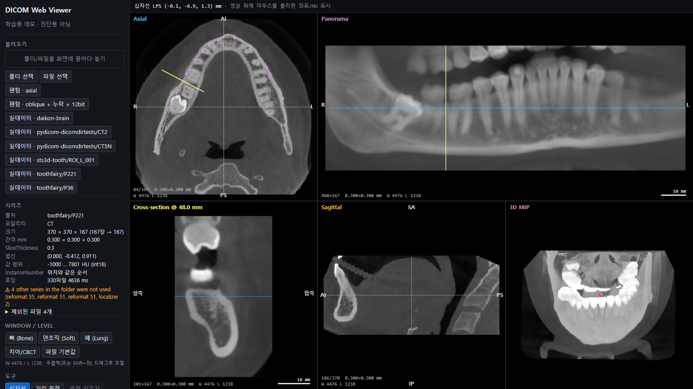
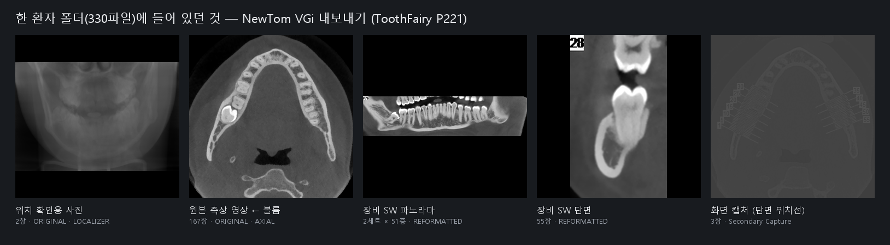
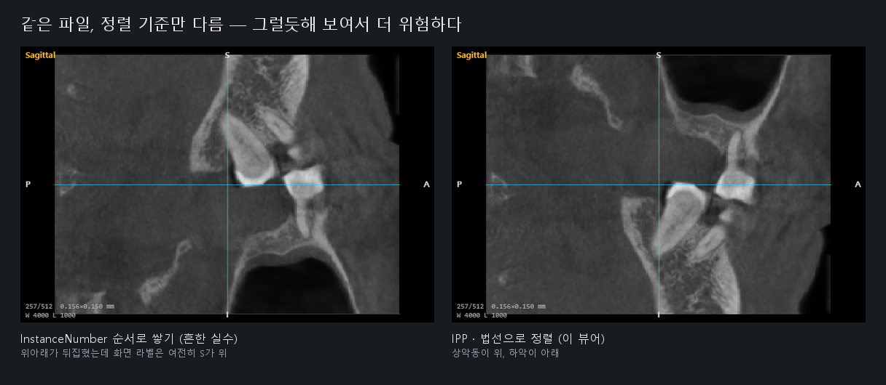
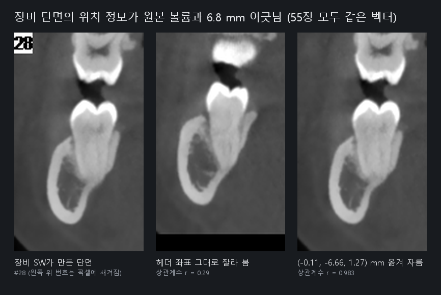
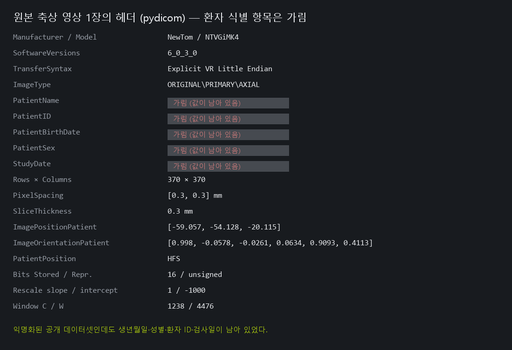
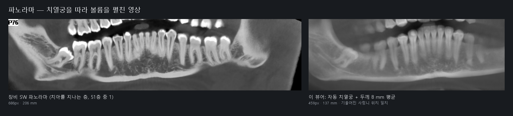

# DENTAL-LOG — 치과 CBCT 실데이터 작업 기록

[DEV-LOG](DEV-LOG.md)의 후속 기록이다. 형식은 같다: **문제 → 원인 → 시도 → 해결 → 검증**.
실제로 겪은 것만 적었다. "추론"이라고 표시한 부분은 직접 확인하지 않은 판단이다.
그림은 `docs/screens/dental/`에 있고, 모두 아래 [재현 절차](#재현-절차)의 스크립트로 다시 만들 수 있다.
그림 속 영상의 출처: ToothFairy(AImageLab, University of Modena and Reggio Emilia, MICCAI 2023 challenge, CC BY-SA)와 STS-3D-Tooth(Wang et al., Scientific Data 2025, CC-BY-4.0). 환자 식별 정보는 넣지 않았다.



## 한눈에

| # | 문제 | 결과 |
|---|---|---|
| D1 | 로그인 없이 받을 수 있는 치과 CBCT DICOM이 없음 | NIfTI 1건 변환, 원본 20 GB zip에서 앞부분만 받아 환자 2명분 추출 |
| D2 | 한 환자 폴더에 시리즈가 5종, 330파일 | "가장 큰 시리즈" 규칙은 우연히 맞았을 뿐 → `ImageType`으로 역할 판정 |
| D3 | InstanceNumber로 쌓으면 위아래가 뒤집히는데 화면은 멀쩡해 보임 | 실험 모드로 재현, 그림으로 남김 |
| D4 | 장비 SW가 만든 단면과 내 단면이 안 맞음 (r = 0.29) | 픽셀은 일치(r = 0.98), **헤더 좌표만 6.8 mm / 12.4 mm 일정하게 어긋남** |
| D5 | 내 로더가 맞는지 독립적으로 확인 | ITK(SimpleITK/GDCM)와 원점·방향 일치, 무작위 400점 × 2명 값 100% 일치 |
| D6 | 공개 데이터인데 생년월일 등이 남아 있음 | 픽셀에 새겨진 글자·오버레이까지 확인 → 업로드 단계의 익명화 요구사항 정리 |
| D7 | 치과 뷰어의 기본 화면인 파노라마가 없음 | 자동 치열궁 추정(RANSAC) + 파노라마 + cross-section 구현 |

---

## 2026-10-27

### D1. 치과 CBCT 원본 DICOM 구하기

- **문제**: 치과 CBCT 공개 데이터 중 로그인 없이 받을 수 있는 DICOM이 없었다.

  | 데이터 | 형식 | 접근 |
  |---|---|---|
  | [STS-3D-Tooth](https://huggingface.co/datasets/MedOtter/STS-3D-Tooth) | NIfTI | 바로 받음, CC-BY-4.0 |
  | [ToothFairy](https://ditto.ing.unimore.it/toothfairy) | 원본 DICOM | 회원가입, CC BY-SA, **약 20 GB 한 덩어리** |
  | ToothFairy2·3·4 | NIfTI / mha | 회원가입 |
  | PhysioNet Multimodal Dental | DICOM | 자격 심사 |

- **시도 1 — NIfTI를 DICOM으로 변환** (`scripts/nifti_to_dicom.py`, nibabel + pydicom)
  - NIfTI 좌표는 **RAS**, DICOM은 **LPS**다. x와 y 부호를 뒤집지 않으면 좌우와 앞뒤가 바뀐다.
  - 변환 결과를 기존 로더에 넣어 경고 없이 열리는 것을 확인했다(0.156 mm, 512×512×400).
  - 한계: 내가 만든 DICOM이라 장비 특유의 사정이 하나도 없다.
- **시도 2 — 원본 20 GB 중 일부만 받기**
  - ToothFairy GitHub 저장소(`AImageLab-zip/ToothFairy`)를 확인했지만 대회 코드만 있었다. 데이터처럼 보이는 `.mha` 4개는 133바이트짜리 Git LFS 포인터였다.
  - zip은 목차(central directory)가 **맨 끝**에 있어서, 받다 만 파일은 탐색기에서 "손상됨"으로 열리지 않는다.
  - 하지만 파일마다 앞에 local header가 붙어 있다. 그래서 순차로 읽는 `bsdtar`(Windows 기본 `tar.exe`)는 앞부분을 꺼낼 수 있다.
  - Git Bash의 `tar`는 GNU tar라 zip을 못 읽었다. `C:\Windows\System32\tar.exe`를 직접 지정했다.
  - 820 MB까지 받은 시점의 복사본에서 환자 20명 이상이 확인됐다. 그중 2명(P221, P36)을 꺼냈다.
- **결과**: NewTom VGi(이탈리아 치과 CBCT, 110 kV)의 원본. 비압축 Explicit VR Little Endian, 0.3 mm 등간격, unsigned 16 bit, Intercept −1000.

### D2. 한 폴더에 시리즈가 5종 — "가장 큰 시리즈"는 우연히 맞았다



- **문제**: P221 폴더 330파일은 하나의 볼륨이 아니었다.

  | 시리즈 | 장수 | ImageType | 정체 |
  |---|---|---|---|
  | 1 | 2 | ORIGINAL\PRIMARY\LOCALIZER | 위치 확인용 투영 사진 |
  | 11 | 167 | ORIGINAL\PRIMARY\AXIAL | **원본 볼륨** |
  | 21 | 55 + 캡처 1 | DERIVED\SECONDARY\REFORMATTED | 장비 SW가 만든 cross-section |
  | 31, 32 | 51 + 캡처 1씩 | 〃 | 장비 SW 파노라마, 깊이별 51층 |
  | — | 1 | — | DICOMDIR |

- **원인**: 재구성 영상에도 IPP/IOP가 들어 있다. 다만 장마다 방향이 다르다(시리즈 21은 55장에 IOP 20종, 파노라마는 35~50종). 쌓을 수 있는 볼륨이 아니다.
- **기존 동작**: 장수가 가장 많은 시리즈를 골랐다. 이 데이터에서는 원본이 167장으로 가장 많아서 **우연히** 맞았다. 장비가 단면을 200장 내보냈다면 틀린 시리즈를 골랐을 것이다.
- **해결** (`src/dicom/volume.ts` `seriesRole`): 시리즈의 역할을 판정하고, 역할 순서로 고른다.
  - LOCALIZER → localizer
  - DERIVED / SECONDARY / REFORMATTED, 또는 장마다 방향이 다름 → reformat
  - 나머지 ORIGINAL → acquired volume
  - 순위: acquired volume > other > reformat > localizer. 같은 역할 안에서는 장수가 많은 쪽.
  - 화면 경고도 `4 other series ... (reformat 55, reformat 51, reformat 51, localizer 2)`처럼 무엇을 버렸는지 보여 준다.
- **검증**: `tests/external.test.ts` — P221, P36 모두 원본이 선택되고, 나머지의 역할이 위와 같은지 확인한다.

### D3. 잘못 쌓아도 화면은 그럴듯해 보인다



- **문제**: InstanceNumber 순서로 쌓고 SliceThickness를 간격으로 쓰는 것이 가장 흔한 실수다. 그 결과가 어떻게 보이는지 직접 보여 줄 그림이 필요했다.
- **해결**: 시연 전용 옵션 `?order=naive`를 추가했다(`BuildOptions.ordering`). 켜면 경고가 `EXPERIMENT: ...`로 표시된다.
- **관찰**: 번호 순서가 위치와 반대인 시리즈(STS 변환본)를 이렇게 쌓으면 상악동이 아래, 하악이 위로 간다. 그런데 화면의 방향 글자는 여전히 위가 S다. 글자는 IOP에서 계산하는데, 그 IOP 자체는 맞기 때문이다. **영상만 봐서는 틀린 줄 모른다.**
- 참고: 실제 NewTom 파일은 InstanceNumber가 위치 순서와 같았다. 이 실수가 항상 드러나지는 않는다는 뜻이다.

### D4. 장비 SW 단면의 위치 정보가 원본 볼륨과 6.8 mm 어긋난다



이번 작업에서 가장 오래 걸렸고, 중간에 내 측정 코드의 버그도 두 번 만났다.

- **동기**: 장비 SW가 만든 cross-section 55장은 장마다 IPP/IOP/PixelSpacing을 가진 **평면 영상**이다. 같은 평면을 내 볼륨에서 잘라 보면 내 재샘플링을 장비 SW와 수치로 비교할 수 있다. 정답지로 쓰려고 했다.
- **문제**: 헤더대로 잘라 비교하니 상관계수 중앙값이 **0.30**(P221), **0.05**(P36)였다. 같은 해부 구조를 자르고 있지 않다는 뜻이다.
- **추적**
  1. 단면 한 장의 네 모서리를 내 볼륨의 복셀 좌표로 바꿔 보니, 세로 범위가 볼륨보다 약 13 슬라이스(4 mm) 아래로 밀려 있었다.
  2. 그림으로 겹쳐 보니 같은 치아였다. 몇 mm 밀린 것뿐이었다. 2D 템플릿 매칭으로 r = 0.88, 이동 4.1 mm를 얻었다.
  3. 평면 안 이동만으로는 부족해서, 평면에 수직인 방향까지 3D로 탐색했다. 처음엔 탐색 범위(±1.5 mm) 끝에 걸렸다. 범위를 −7~+1 mm로 넓히니 55장 **모두 같은 LPS 벡터**로 수렴했다.
- **도중에 만난 내 버그 1 — 상관계수 계산**: 영상 밖(NaN) 픽셀을 뺄 때 평균을 그 부분집합으로 다시 계산하지 않았다. 그래서 r이 1.00처럼 부풀려졌다. 피어슨 식을 부분집합 기준으로 고쳤고, 결론(이동 벡터)은 그대로였다.
- **도중에 만난 내 버그 2 — 검증 쪽이 틀렸다**: 찾은 이동량으로 직접 잘라 보면 r = 0.12가 나왔다. 탐색과 직접 계산이 어긋났다.
  - 같은 스크립트에서 두 방식을 나란히 계산했더니 샘플링 결과는 픽셀 단위로 같았다(최대 차이 0).
  - 차이는 비교 대상에 있었다. 장비 SW가 단면 번호("28")를 **픽셀값 65535로 영상에 직접 새겨 넣었다.** 탐색은 그 구석을 빼고 계산했고, 직접 계산은 포함했다.
  - 이 500여 개의 흰 픽셀이 피어슨 상관을 망가뜨렸다. 포화 픽셀(저장값 = 2^BitsStored − 1)을 빼자 r = 0.998이었다.
- **결론**

  | 환자 | 헤더 그대로 (r 중앙값) | 이동 벡터 LPS (mm) | 크기 | 이동 후 r 중앙값 (최소) |
  |---|---|---|---|---|
  | P221 | 0.30 | (−0.11, −6.66, +1.27) | 6.8 mm | 0.982 (0.888) |
  | P36 | 0.05 | (−0.40, −10.10, −7.25) | 12.4 mm | 0.980 (0.920) |

  - 장비 SW 단면의 **픽셀 내용**은 원본 볼륨을 다시 자른 것과 같다. 내 trilinear 재샘플링이 장비 SW와 사실상 같은 영상을 만든다는 뜻이기도 하다.
  - 하지만 **헤더 좌표**는 한 스캔 안에서 일정한 벡터만큼 어긋나 있고, 그 크기는 스캔마다 다르다. 두 시리즈는 FrameOfReferenceUID가 같아서, 표준대로라면 같은 좌표계여야 한다.
  - 어느 쪽이 "맞는" 좌표인지는 이 데이터만으로는 가릴 수 없다. 다만 원본 축상 시리즈를 내 로더와 ITK가 똑같이 해석한다(D5).
  - **추론(재현 안 함)**: 장비 SW가 재구성 좌표를 내보내기 전 내부 볼륨(크롭·기울기 보정 전) 기준으로 계산했을 수 있다. P36의 축상 영상은 370×300으로 잘려 있고 이동량도 더 크다.
- **왜 중요한가**: 장비 SW 화면에서 찍은 점(임플란트 위치, 신경관)을 헤더 좌표로 원본 볼륨에 옮기면 6.8~12.4 mm가 틀어진다. 하치조신경관과 임플란트 사이 안전거리는 보통 2 mm 정도다. 데스크톱 뷰어와 웹 뷰어가 **"같은 점을 가리키는지"는 헤더를 믿지 말고 영상으로 확인해야 한다**는 실례다.
- **검증**: `tests/external.test.ts` — 헤더 그대로는 r < 0.5, 이동 후 r > 0.95 (두 환자 각 55장).

### D5. ITK와 교차 검증

- **목적**: 내 로더의 해석이 표준 구현과 같은지 확인하려 했다. 포트폴리오에 "기준 뷰어와 비교"라고 적어 둔 약속이기도 하다.
- **방법**: `scripts/validate_sitk.py`로 같은 폴더를 SimpleITK 2.5.6(GDCM)으로 읽었다. 3D Slicer의 DICOM 볼륨 로딩이 이 계열 위에 있다. 무작위 복셀 400개의 LPS 좌표와 값을 JSON으로 쓰고, 테스트가 내 로더로 같은 LPS 점의 값을 읽어 비교한다.
- **결과** (P221, P36)
  - 원점: 소수점 셋째 자리까지 같음 (P221 −59.057, −43.865, −42.801)
  - 방향 행렬: 같음
  - 값: 400 / 400점 정확히 일치 (두 환자 모두)
  - ITK가 "Non uniform sampling, max 0.00075 mm"라고 경고했다. 내 로더는 같은 차이를 허용 오차(간격의 2%) 안으로 보고 균일로 판정한다. 둘 다 리샘플링 없이 같은 격자를 만든다.
- **선택 규칙도 맞췄다**: ITK 스크립트도 처음엔 "가장 큰 시리즈"를 골랐다. D2와 같은 이유로 ORIGINAL·비-LOCALIZER 우선으로 바꿨다.
- **남은 것**: 3D Slicer GUI에서 직접 점을 찍어 비교하지는 않았다. Slicer 화면은 RAS로 표시되므로 x, y 부호가 반대로 보일 것이다.

### D6. "익명화된" 공개 데이터에 남아 있던 것



- **관찰**
  - 환자 이름은 "PROVA221"(이탈리아어로 "테스트")로 바뀌어 있었다. 그런데 **생년월일, 성별, 환자 ID, 검사일**은 그대로였다.
  - `PatientIdentityRemoved`, `DeidentificationMethod` 태그는 없었다.
  - 영상 안에도 정보가 있었다. 재구성 영상에는 번호가 **픽셀에 새겨져** 있었고(D4), 오버레이 평면 3개(`Generic`, `Implant`, `Marker`)가 별도로 들어 있었다.
- **조치**
  - 원본은 `data/external/**/raw/`에만 두고 git에서 제외했다. 뷰어는 환자 태그를 화면에 표시하지 않는다.
  - 문서용 헤더 그림에서는 식별 항목을 가렸다.
- **클라우드 업로드로 옮기면**(설계, 구현 안 함)
  - 업로드 전 또는 수신 직후에 태그 익명화를 한다. DICOM PS3.15 Basic Profile 기준이다.
  - 태그 익명화로는 **픽셀에 새겨진 글자와 오버레이가 지워지지 않는다.** 장비별 burned-in 위치 규칙이나 OCR 검사가 따로 필요하다.
  - 원본 보관 여부와 접근 권한은 정책으로 정한다.

### D7. 파노라마와 cross-section



- **문제**: 치아는 U자 곡선 위에 있어서 axial, coronal, sagittal로는 한 줄로 볼 수 없다. 치과 뷰어의 기본 화면은 곡선을 따라 펼친 파노라마와, 곡선에 수직인 단면이다.
- **구현** (`src/dental/`)
  - 곡선: 축상면 위 제어점을 Three.js `CatmullRomCurve3`(centripetal)로 잇는다. `getSpacedPoints`로 **호의 길이 기준 등간격** 샘플을 얻는다. 그래야 파노라마 가로 1픽셀이 곡선 위 일정한 mm가 된다.
  - 파노라마: 각 샘플에서 곡선의 법선(협측 방향)으로 ±두께/2를 trilinear로 샘플해 평균한다. 세로축은 볼륨의 k축이다. 장비 SW 재구성도 IOP 열 벡터가 볼륨 법선의 반대였다. 같은 선택이다.
  - cross-section: 샘플 위치에서 법선 방향 30 mm × 볼륨 높이. 왼쪽이 설측, 오른쪽이 협측이다.
  - 화면: 파노라마를 클릭하면 단면 위치와 십자선이 옮겨진다. 단면 위에서 휠을 돌리면 1 mm씩 이동한다. 축상면에 곡선과 단면 위치선을 그린다.
- **자동 치열궁 추정** (`src/dental/arch.ts`)
  - 고정 임계값은 쓰지 않았다. CBCT의 "HU"는 장비마다 다르다. P221은 원본 범위가 −1000~7801, 변환한 STS는 −1000~3095였다. 대신 축상 10 mm 슬랩 MIP에서 **밝은 상위 6%**를 후보로 쓴다.
  - 후보에는 척추, 설골, 금속 줄무늬가 섞인다. 최소제곱 대신 **RANSAC**으로 포물선 y = ax² + bx + c를 맞춘다. 3점 표본 400회, 오차 2.5 mm 이내를 inlier로 센다.
  - P221 중간 슬라이스 결과: 임계값 1929, 후보 8217점 중 2475점이 inlier, 곡선 길이 137 mm, 약 0.45초.
- **장비 SW와 비교한 한계**
  - 장비 파노라마는 206 mm(양쪽 하악지까지)이고 내 자동 곡선은 137 mm다. 오른쪽 어금니 뒤가 잘린다. 포물선 하나로는 하악지 쪽으로 꺾이는 모양을 못 따라간다.
  - 두께 8 mm 평균이라 장비의 얇은 층보다 흐리다. 자동 추정은 첫 추정으로 두고, "직접 찍기"로 고칠 수 있게 했다.
- **검증** (`tests/dental.test.ts`, 합성 턱)
  - 포물선 계수 복원
  - 곡선 길이가 해석해와 같음
  - 샘플 간격이 일정함(편차 < 0.02 mm)
  - 치아(구)가 호의 길이로 계산한 열에 나타남
  - 치아를 지나는 단면의 가운데가 치아임
  - 평면 샘플링이 격자와 일치함

### 메모: 공개 데이터셋의 메타데이터

- STS-3D-Tooth의 `Integrity_L_001.nii.gz`는 복셀이 **1.0 mm**로 적혀 있다. 512×512×400이면 촬영 범위가 51 cm가 된다. 치과 CBCT로는 불가능한 크기다(보통 수 cm~23 cm). 같은 데이터셋의 ROI 버전은 0.156 mm다.
- 이 값을 믿고 측정하면 길이가 약 6.4배로 나온다. 원인은 확인하지 않았다(추론: 변환 과정에서 간격 정보 손실).

---

## 재현 절차

```bash
# 0) 개발 서버
npm run dev                                   # http://localhost:5190

# 1) STS-3D-Tooth 1건 (NIfTI → DICOM)
pip install nibabel pydicom numpy
#   ROI_L_001.nii.gz, ROI_L_001 마스크를 Hugging Face에서 받아 data/external/sts3d-tooth/nifti/ 에 둔다
python scripts/nifti_to_dicom.py data/external/sts3d-tooth/nifti/ROI_L_001.nii.gz \
       data/external/sts3d-tooth/raw/ROI_L_001 --mask data/external/sts3d-tooth/nifti/ROI_L_001_mask.nii.gz

# 2) ToothFairy 원본 일부 (회원가입 후 브라우저로 받는 중인 파일의 '복사본'에서)
#    Windows 기본 tar(bsdtar)를 쓴다. Git Bash의 tar는 zip을 못 읽는다.
C:\Windows\System32\tar.exe -tf C:\data\tf\partial.zip            # 환자 폴더 목록
C:\Windows\System32\tar.exe -xf C:\data\tf\partial.zip -C data\external\toothfairy\raw P221 P36

# 3) ITK 교차 검증용 기준값
pip install SimpleITK
python scripts/validate_sitk.py data/external/toothfairy/raw/P221 data/external/toothfairy/P221.sitk.json
python scripts/validate_sitk.py data/external/toothfairy/raw/P36  data/external/toothfairy/P36.sitk.json

# 4) 테스트 (데이터가 없으면 해당 항목은 건너뜀)
npm test

# 5) 그림 (docs/screens/dental/)
npx vite-node scripts/dental-figures.ts data/external/toothfairy/raw/P221 <tmp>
node scripts/screens-dental.mjs <tmp>
python scripts/compose_dental_figures.py data/external/toothfairy/raw/P221 <tmp> docs/screens/dental
#   01-dental-mode.png는 screens-dental.mjs가 <tmp>에 쓴 것을 복사

# 화면에서 바로 보기
#   http://localhost:5190/?sample=ext:toothfairy/P221&dental=1        치과 모드
#   http://localhost:5190/?sample=ext:sts3d-tooth/ROI_L_001&order=naive  D3 실험
```
